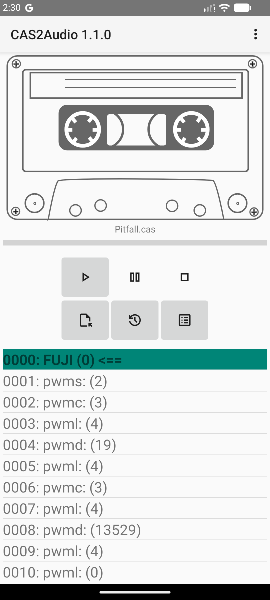
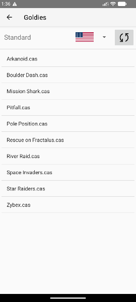
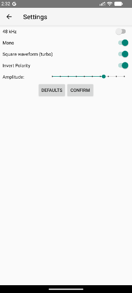

# CAS2Audio

Play back tape images for 8-bit Atari computers on mobile devices with Android.

## Overview

* CAS2Audio plays back Atari 8-bit tape images (.CAS files) on small portable devices
(phones, tablets) running Android
* CAS2Audio is a satellite project of TURGEN - <https://turgen.sourceforge.io/>,
a tool for creating Atari tapes

### Screenshots

  

### Highlights

* Simple, easy to use user interface with easy access to the recently selected tape images
* Support for both standard records (FUJI, baud, data, fsk) and turbo records (pwms, pwmc, pwmd,
  pwml)
* You can pause the playback and resume from any tape image chunk
* The signal is generated on-the-fly (no temporary wave files are needed)
* Displays animated cassette during playback
* Full support for landscape screen format and live screen rotation and color scheme changes 
* Goldies archive. Quick access to tape images of popular games from the past. 

## Quick Start

You need an 8-bit Atari computer, data recorder, cassette adapter, and a smartphone running Android.

* Install CAS2Audio on your smartphone running Android
* Open the app, select the Goldies function and then select the Refresh button. This will automatically download a small
archive of tape images with popular games. Select the game of your choice, e.g. River Raid. This will open the respective tape image.
* Connect your data recorder to the Atari computer
* Insert a cassette adapter in the data recorder and connect the cassette adapter to the headphone
  jack of your smartphone
* Prepare the Atari computer to load data
* Press PLAY on your data recorder
* Press a key on your computer to begin the loading
* Select the PLAY button in the CAS2Audio app.
* The computer will load the game

## Technical information

### OS Version

At least Android 12.0 (API 31) is required to run the most recent version

### Installation

* Download the .apk package from the "Releases" section
* Open the .apk package. As the .apk package doesn't come from Google Play, it will be reported
  as unknown or insecure. You will need to confirm that you want to install the package anyway.
* If the installation fails, you might need to uninstall the previous version first

### Available settings

* Mono or Stereo output
* 44100 Hz and 48000 Hz sampling rates
* For turbo records, you can choose waveform - sine wave or square wave
* Adjustable signal amplitude

### Permissions

* Read only access to storage
* Wake lock (to prevent the device from sleeping when playing back)

### Goldies

* The Goldies archive is downloaded from https://baktra.wz.cz/packages/goldies.zip
